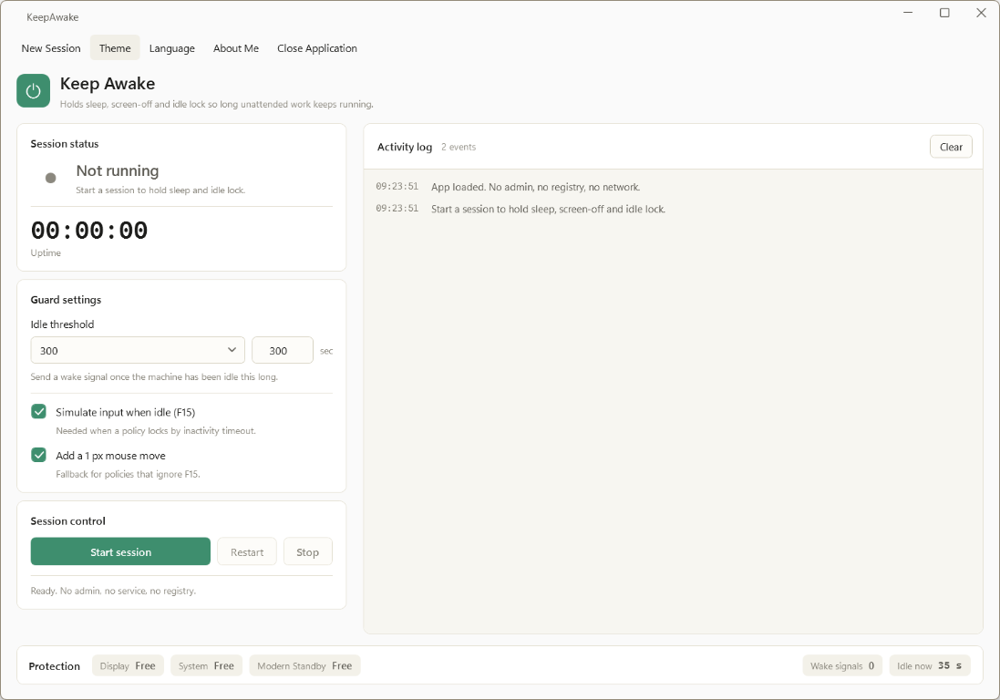
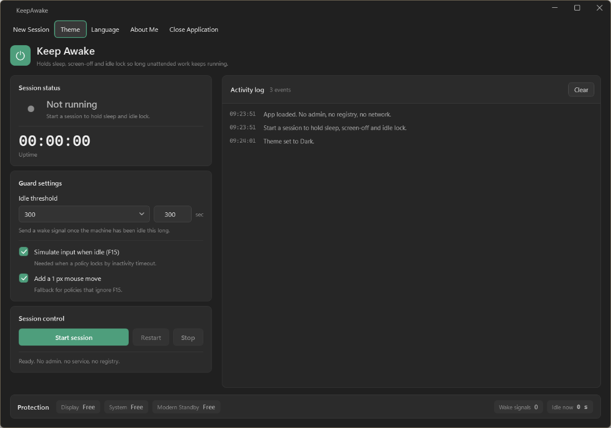

<p align="center">
  
</p>

<h1 align="center">KeepAwake</h1>

<p align="center">
  <strong>Keep your Windows machine awake — no admin, no service, no registry edits.</strong><br />
  A native WPF desktop utility that silently holds sleep, screen-off and idle-lock while your long-running work finishes itself.
</p>

<p align="center">
  <a href="#download"></a>
  <a href="#build-from-source"></a>
  
  
</p>

<p align="center">
  <em>Renders panjang, unduhan besar, build CI, presentasi berjam-jam, dashboard monitoring — semua tetap jalan walau komputer idle.</em>
</p>

---

## ✨ Features

| Feature | Description |
| --- | --- |
| 🛡️ **Silent sleep hold** | Keeps `display` + `system` power states active via `SetThreadExecutionState` — Windows won't sleep, screen won't turn off, and idle-lock stays disarmed. |
| 🔌 **Modern Standby aware** | Uses `PowerCreateRequest` / `PowerSetRequest` so the hold survives S0 Low-Power Idle (Modern Standby) laptops. |
| ⌨️ **Wake signal simulation** | Sends an invisible `F15` keystroke (the documented "wake" key) the moment the machine hits your idle threshold — defeats inactivity-timeout policies without actually touching your keyboard. |
| 🖱️ **1 px mouse nudge (optional)** | Fallback for policies that ignore `F15` — moves the cursor by one pixel, imperceptible to the user. |
| ⏱️ **Configurable idle threshold** | 15 / 30 / 45 / 60 / 90 / 120 / 180 / 300 / 600 seconds, or any custom value between 10 and 600. |
| 🎨 **Light / Dark / Follow system** | Fluent 2 palette with a curated warm-green accent. Switches instantly and persists. |
| 🌐 **English & Bahasa Indonesia** | Every UI string — including the existing activity log — re-translates on the fly. |
| 💾 **Settings persistence** | Theme, language, interval, and toggle state survive restarts via `keepawake.config.json` next to the executable. |
| 🪶 **Portable & single-file** | Self-contained `win-x64` publish. No installer, no dependencies, no .NET runtime required on the target machine. |
| 🔒 **Zero privileges** | Runs as a normal user. No UAC prompt, no service, no registry writes, no network calls. |

## 🎨 Design Language

Built with **WPF-UI 4.3.0** (Fluent 2) on **.NET 9**, the interface borrows the same card-and-palette vocabulary used by modern Windows 11 utilities:

- **Titlebar** extends content into the caption area with transparent caption buttons.
- **Menu row**: `New Session` · `Theme` · `Language` · `About Me` · `Close Application` — five explicit menu entries in the user's exact requested order.
- **Session status card** with a concentric pulse animation that breathes outward while the guard is active, beside a 30 px tabular-mono uptime readout.
- **Guard settings card** with a Fluent ComboBox (preset picker) paired with a free-form TextBox for custom values.
- **Session control card** with primary / secondary / danger buttons and a one-line readiness hint.
- **Activity log card** on the right — color-coded rows (success / warning / danger), capped at 400 entries, re-translated on language switch.
- **Protection bar** at the bottom — real-time `Display / System / Modern Standby` hold state, wake-signal counter, and current idle timer.

## 📸 Screenshots

<table>
  <tr>
    <td width="50%"><strong>Light theme</strong></td>
    <td width="50%"><strong>Dark theme</strong></td>
  </tr>
  <tr>
    <td></td>
    <td></td>
  </tr>
</table>

## 📥 Download

Pre-built self-contained binaries are published on the [Releases page](../../releases):

- `KeepAwake.exe` — single portable executable, drag anywhere, run.
- `KeepAwake-vX.Y.Z-win-x64.zip` — the complete self-contained package (useful for air-gapped machines or archive).

Both are **`win-x64` self-contained**, so you do **not** need to install the .NET runtime on the target machine.

> 💡 **Tip:** on first run, Windows SmartScreen may show a warning because the binary is not code-signed. Click *More info → Run anyway* — the source is fully open in this repository and you can rebuild it yourself in one command.

## 🚀 Quick Start

1. Grab `KeepAwake.exe` from the [latest release](../../releases/latest).
2. Double-click to launch.
3. Click **Start session** — the pulse animation starts, the protection chips flip to *Held*, and the machine stays awake until you press **Stop** or close the window.
4. Tweak the idle threshold if you need a different trigger window.
5. Switch theme / language from the menu row — your choice is persisted next to the executable.

## 🛠️ Build from Source

Requirements:
- [.NET 9 SDK](https://dotnet.microsoft.com/en-us/download/dotnet/9.0) (only needed to build, **not** to run).

```bash
git clone https://github.com/triastantobimo-ux/KeepAwake.git
cd KeepAwake
dotnet publish KeepAwake.csproj -c Release -r win-x64 --self-contained true -o publish
```

The runnable `publish/KeepAwake.exe` is the self-contained output.

To build a framework-dependent (smaller) version that requires .NET 9 on the target machine:

```bash
dotnet publish KeepAwake.csproj -c Release -r win-x64 --self-contained false -o publish-fx
```

## 🧩 Project Layout

```
KeepAwake/
├── KeepAwake.csproj         # WPF net9.0-windows project
├── app.manifest             # PerMonitorV2 DPI, Win10/11 supportedOS
├── App.xaml / App.xaml.cs   # Theme / language / config bootstrap
├── MainWindow.xaml / .cs    # Shell + menu row + protection bar + pulse
├── AboutWindow.xaml / .cs   # About dialog
├── Core/
│   ├── Native.cs            # P/Invoke: SetThreadExecutionState, SendInput, Power*
│   ├── PowerRequest.cs      # Modern Standby power request wrapper
│   ├── AwakeGuard.cs        # Worker-thread keep-awake engine
│   └── LogEntry.cs          # Structured log model
├── Services/
│   ├── Loc.cs               # EN/ID localization singleton (~90 keys)
│   └── AppConfig.cs         # JSON persistence next to the executable
├── ViewModels/
│   ├── MainViewModel.cs     # MVVM state + command surface
│   ├── LogRow.cs            # Localized log renderer
│   └── InverseBoolToVisibility.cs
├── Themes/
│   ├── Controls.xaml        # Fluent 2 component styles (buttons, cards, chips…)
│   ├── Palette.Light.xaml   # Light theme brush tokens
│   └── Palette.Dark.xaml    # Dark theme brush tokens
├── Assets/
│   └── AppIcon.ico          # Multi-size app icon
└── legacy/
    ├── KeepAwake.WinForms.cs    # Archived original WinForms source
    └── KeepAwake.WinForms.exe   # Archived original WinForms binary (reference only)
```

## 🔍 How It Works

At its core KeepAwake runs a single long-lived worker thread that:

1. Asserts `SetThreadExecutionState(ES_CONTINUOUS | ES_SYSTEM_REQUIRED | ES_DISPLAY_REQUIRED)` — this tells Windows to keep the display and system powered while the thread lives. (Flags are thread-affine, which is why we need a dedicated thread.)
2. On Modern Standby machines, additionally issues `PowerCreateRequest` + `PowerSetRequest` for `PowerRequestSystem` and `PowerRequestDisplay` so S0 Low-Power Idle doesn't override the hold.
3. Polls `GetLastInputInfo` every second. Once the idle duration exceeds the configured threshold and input simulation is enabled, it synthesizes a single `F15` (VK 0x7E) key event via `SendInput` — invisible to the user, but counted as "activity" by Windows' inactivity-timeout policies. Optionally nudges the cursor by 1 pixel.
4. Re-asserts the execution-state flags every 30 s (some systems clear them after a while).
5. On `Stop()` / window close, clears the flags, releases the power requests, and joins the worker — leaving the machine to behave normally again.

## 🗂️ Persistence

`keepawake.config.json` is written beside the executable on every change and re-read on startup:

```json
{
  "Theme": "Light",
  "Language": "en",
  "IntervalSeconds": 60,
  "SimulateInput": true,
  "NudgeMouse": false
}
```

Delete the file to reset to defaults (`System` theme, `en`, 60 s, simulate on, nudge off).

## 📝 License

Released under the [MIT License](LICENSE).

## 👤 Credits

Designed and developed by **Bimo Gusha Triastanto** as a lightweight, native, powerful Windows desktop utility.

---

<p align="center">
  <sub>Built with ❤ using <a href="https://github.com/lepoco/wpfui">WPF-UI</a> and <a href="https://github.com/CommunityToolkit/dotnet">CommunityToolkit.Mvvm</a>.</sub>
</p>
